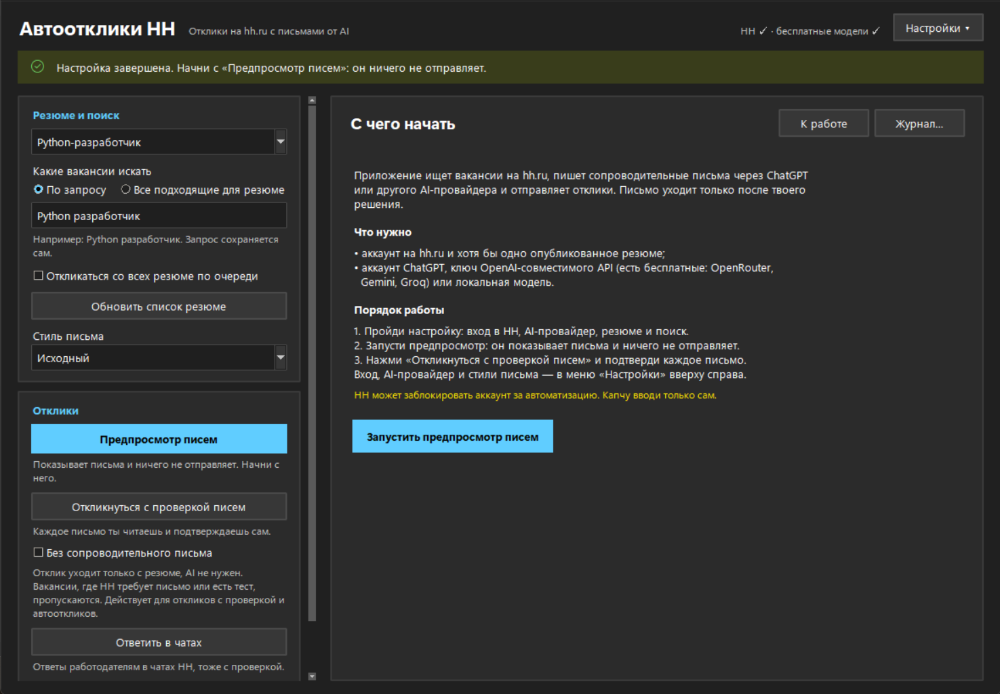
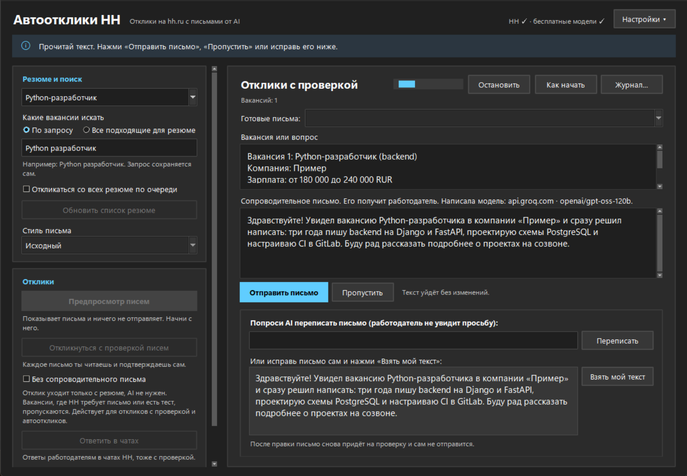
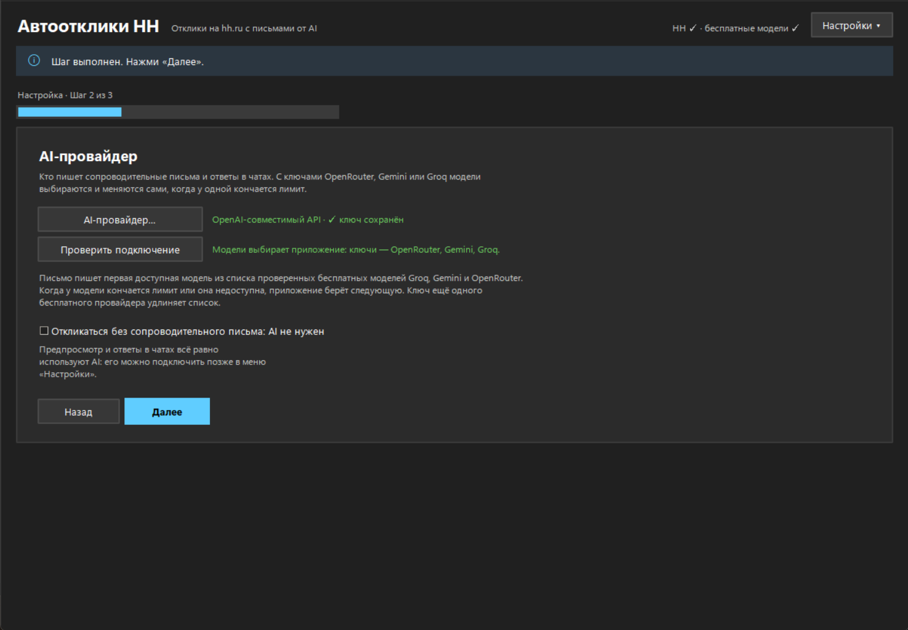

Warning: truncated output (original token count: 19901)
Total output lines: 211

# HH applicant tool — локальный запуск на Windows

> **Новичкам:** [скачать «Автоотклики HH» и пройти пошаговое руководство](docs/guide.md). Страница загрузки для будущего GitHub Pages находится в [`docs/index.html`](docs/index.html).

> [!IMPORTANT]
> **Капчу HH проходишь ты сам, вручную.** Приложение не распознаёт и не обходит капчу. Когда HH просит её, открывается окно «Капча» с картинкой: текст вводит человек, после этого отклик продолжается. Пока окно открыто, запуск ждёт. Если закрыть окно или ввести текст неверно, запуск останавливается. Поэтому автоотклики не работают совсем без присмотра: держи приложение на виду.

**Форк [s3rgeym/hh-applicant-tool](https://github.com/s3rgeym/hh-applicant-tool).** Этот репозиторий — форк оригинального проекта с графическим интерфейсом и обвязкой для Windows. Код оригинала здесь не хранится: приложение ставит пакет [`hh-applicant-tool`](https://pypi.org/project/hh-applicant-tool/) 2.3.7 из PyPI как зависимость. Поиск вакансий, работа с API HH и отправка откликов — заслуга автора оригинала.

Проект для поиска вакансий HH, генерации сопроводительных писем через локальный шлюз ChatMock и отправки откликов: ручной с подтверждением каждого письма или отдельной автоматической с заданным лимитом. Расписания и фоновой отправки нет. HH предупреждает, что программы, имитирующие действия пользователя, могут привести к блокировке аккаунта.

## Оконный интерфейс Windows: «Автоотклики HH» 0.6.0-beta.1

**0.6.0-beta.1 — бета.** Её ставят только вручную: установщик на странице релиза отмечен как pre-release. Автообновление бету не предлагает, установки 0.5.0 остаются на 0.5.0. Бета-установка сама обновится до 0.6.0, когда выйдет финальная версия.

**Установщик:** `hh-applicant-tool-gui-<версия>-windows-x64-setup.exe` и `SHA256SUMS.txt` — на странице [Releases](https://github.com/nikchester/hh-applicant-tool-gui/releases/latest). Он включает Python: терминал и ручная установка Python не нужны. Установка идёт для текущего пользователя без прав администратора; ярлык на рабочем столе необязателен, приложение само не запускается. Изменения версии — в [CHANGELOG.md](CHANGELOG.md).

### Скриншоты

Главный экран: блок «Резюме и поиск» со стилем письма, блок «Отклики» и меню «Настройки ▾» вверху справа.

Отклик с проверкой: вакансия, письмо и модель, которая его написала. Письмо можно отправить, пропустить, попросить AI переписать или исправить самому.

Мастер первого запуска, шаг «AI-провайдер»: с ключами бесплатных API модели выбираются и меняются сами.

Скриншоты сняты на одноразовом профиле с вымышленными вакансией и резюме.

**Стили письма.** В окне «Стиль письма…» можно хранить несколько стилей: создать, дублировать, переименовать и удалить. Активный стиль выбирается в блоке «Резюме и поиск» на главном экране и действует на следующем предпросмотре. Встроенный стиль «Исходный» не меняется; чтобы изменить его, нажми «Дублировать».

**Автообновление.** С версии 0.4.0 программа сама проверяет релизы этого репозитория. Кнопка «Обновить до X» справа вверху ставит новую версию без повторной установки. Программа проверяет подпись релиза; закрытый ключ подписи хранится только в секрете CI `UPDATE_SIGNING_KEY`. Подробности — в [CHANGELOG.md](CHANGELOG.md), раздел 0.4.0.

Релиз собирает CI ([.github/workflows/release.yml](.github/workflows/release.yml)): тег `vX.Y.Z` запускает офлайн-тесты, сборку установщика и публикацию релиза с разделом версии из CHANGELOG.md. Тег должен совпадать с `APP_VERSION` в `windows/packaging/manifest.py`. Локальная сборка и portable-вариант — [windows/packaging/README.md](windows/packaging/README.md), скрипт — [windows/build-installer.ps1](windows/build-installer.ps1).

**Что проверено для 0.2.0:** все офлайн-наборы тестов, сборка PyInstaller, аудит приватности frozen-сборки, оба smoke-режима exe, запуск окна exe на временном профиле, тихая установка, запуск установленного exe, удаление и обновление поверх 0.1.0 (ярлык «PocketNode HH» заменяется на «Автоотклики HH», папка установки сохраняется). **Не проверено:** реальные входы в HH и ChatGPT и реальные отклики — тесты работают без аккаунтов и сети. Сборка не подписана и может вызвать предупреждение SmartScreen; не обходи защиту Windows. До распространения нужно уточнить право на перераспространение HH: в его wheel лицензия не указана. Публикация не выполнялась.

**Альтернатива для разработчика в подготовленном репозитории:** двойной щелчок по [windows/start-gui.wsf](windows/start-gui.wsf) открывает исходный GUI без терминала. Этот вариант требует уже установленного Python и окружений `venvs/hh` и `venvs/chatmock`, ничего не скачивает и не устанавливает. Если Windows Script Host запрещён политикой компьютера, не обходи ограничение. Точка входа — `gui.main()` в `windows/gui.py`; командный эквивалент из корня проекта: `venvs\hh\Scripts\pythonw.exe windows\gui.py`.

**Мастер первого запуска (#5).** Новый профиль открывает только мастер настройки, по одному шагу на экран: «Вход в HH» → «AI-провайдер» → «Резюме и поиск» → «Всё готово». Сверху — «Шаг N из 3»; «Далее» становится доступна, только когда шаг выполнен, «Назад» не теряет введённое. Выбирать модель не нужно: см. «Модели выбираются сами» ниже. С режимом «Откликаться без сопроводительного письма» шаг «AI-провайдер» засчитывается и без AI. «Перейти к откликам» сохраняет отметку о завершённой настройке: следующий запуск сразу открывает главный экран. Профиль, настроенный до появления мастера, тоже открывает главный экран.

**Главный экран** содержит только работу: блок «Резюме и поиск» со стилем письма, блок «Отклики» и свёрнутые автоотклики. Вход, AI-провайдер, стили письма и журнал — в меню «Настройки ▾» вверху справа; рядом статус вида «HH ✓ · бесплатные модели ✓», щелчок по нему открывает то же меню. «Пройти настройку заново» снова открывает мастер. Пока идёт запуск, пункты настройки в меню недоступны. Если вход в HH или ChatGPT истёк либо ключ провайдера пропал, строка статуса предупреждает и показывает одну кнопку: «Войти» или «Изменить ключ». После отказа провайдера в ключе (HTTP 401/403) та же кнопка «Изменить ключ» появляется в итоге запуска. Экран «С чего начать» объясняет порядок работы. Строка статуса меняет цвет по важности: сведения, успех, предупреждение, ошибка.

1. **Вход в HH** (мастер или «Настройки» → «Аккаунт HH…»). «Войти в HH»: поле ввода появляется под кнопкой — сначала email или телефон, затем код из SMS или письма. Шаг мастера «AI-провайдер» («Настройки» → «AI-провайдер и модель…»): «AI-провайдер…» выбирает, кто пишет письма и ответы в чатах (см. ниже). Для ChatGPT через ChatMock — «Войти в ChatGPT»: отдельное окно показывает код и кнопки «Открыть страницу входа» и «Скопировать код». Секреты не передаются в аргументах, окружении или журнале GUI. Окно помнит выполненный вход.
2. **Резюме и поиск** (последний шаг мастера и блок на главном экране). Резюме загружаются сами при запуске и после входа в HH; кнопка «Обновить список резюме» загружает их заново. Выбрать опубликованное резюме. Затем выбрать, какие вакансии искать: «По запросу» — поиск по названию вакансии; «Все подходящие для резюме» — вакансии, которые HH сам подбирает под резюме (раздел «Подходящие вакансии», API `/resumes/{id}/similar_vacancies`). Выбор сохраняется сам, отдельно для каждого резюме.
3. **Стиль письма** (выбирается на главном экране; редактор — «Настройки» → «Стили письма…»). Модель не выбирается вручную: с бесплатными API её выбирает и меняет приложение, с другими провайдерами «Проверить подключение» на шаге «AI-провайдер» выбирает её само. «Стиль письма…» открывает редактор инструкции, по которой модель пишет каждое письмо: тон, длина, обращение. Редактор проверяет подстановки вида `%(vacancy_name)s` и не сохраняет текст с ошибкой; «Вернуть исходный стиль» восстанавливает шаблон. Стиль хранится в профиле GUI, в `[general].cover_letter_prompt`.
4. **Отклики.** «Предпросмотр писем» — до трёх писем без отправки: он читает до 10 вакансий, пропущенные не занимают место писем; письма остаются в списке «Готовые письма». «Откликнуться с проверкой писем» — точный текст письма и вакансия показываются перед кнопками «Отправить письмо» / «Пропустить». Письмо можно исправить так же, как ответ в чате. Свои правки вносятся прямо в поле письма (#17): «Отправить письмо» отправляет текст из поля сразу, без второй проверки; пустое поле не отправляется. Можно и попросить AI переписать письмо (просьба не уходит работодателю): переписанное письмо снова приходит на проверку и само не отправляется, а если в поле уже были правки, AI переписывает исправленный текст. Переписанное AI письмо проходит те же проверки, что и новое; если AI не ответил или письмо не прошло проверку, остаётся прежнее письмо. Свой текст уходит дословно, без проверок. В автооткликах правки нет. Флажок «Без сопроводительного письма» (#9) отправляет отклик только с резюме: AI-провайдер и модель не нужны, ChatMock не запускается. Вакансии, где HH требует письмо или есть тест, пропускаются с причиной в журнале. На проверке видно «Отклик без сопроводительного письма» и кнопку «Отправить отклик»; править там нечего, поле только для чтения. Флажок действует для откликов с проверкой и автооткликов и сохраняется между запусками. Флажок всех резюме включает обход по кругу; для каждого опубликованного резюме нужен запрос или режим «Все подходящие». «Ответить в чатах» — каждый ответ проверяется отдельно и правится так же, прямо в поле; «Отправить ответ» отправляет текст из поля. Если в чате кнопки, ответ выбирается из списка под полем, а поле показывает выбранный вариант. Просьба к ChatGPT переписать ответ не отправляется работодателю, переписанный ответ снова приходит на проверку.
5. **Дополнительно: автоотклики без проверки** — свёрнутый блок. Задать лимит успешных откликов и паузу, затем отдельно подтвердить предупреждение: письма уходят **без проверки каждого**. Паузы не защищают от блокировки HH. Лимит считает только отклики, которые принял HH: пропущенные вакансии, неудачные отправки и повторы после капчи в него не входят. Счётчик во время запуска показывает «Успешных откликов: X из N», а отдельно — отклонённые капчей и отправки без подтверждения HH.

**Журнал.** Технические подробности запусков открываются кнопкой «Журнал…» в отдельном окне, а не во вкладке рядом с письмом. Окно умеет «Скопировать всё» и «Открыть папку с журналом». После ошибки строка статуса показывает причину по-русски и кнопку «Подробнее»; внутренний текст пр…10901 tokens truncated…ю сетевую загрузку.

Для новых запусков Python дополнительно создаёт отдельный HH-only JSONL-журнал: `%USERPROFILE%\.local\state\hh-applicant-tool-cli\run\hh-chats-<случайный UUID>.jsonl`. При ошибке, прерывании, ненулевом результате или незавершённой проверке файл сохраняется, выводится `HH network diagnostic log preserved: …`. Только собственный новый журнал полностью успешной проверки удаляется; предыдущие журналы никогда не удаляются автоматически — после диагностики удали ненужные файлы вручную. При принудительном завершении процесса финальная строка может отсутствовать: такой файл тоже останется. При ошибке записи выводится одно фиксированное предупреждение; исходный результат работы и правила отправки не меняются. Лимит журнала — около 512 КиБ, события сбрасываются на диск после каждой строки; `log_capped` означает прекращение подробной записи с резервом под `run_finished`. Повреждённый или ограниченный журнал сохраняется и при успешной проверке.

В журнале есть версии Python/Requests/urllib3, время UTC и монотонные миллисекунды от начала запуска, сгенерированные `run_id`, `logical_request_id`, `request_id`, `hop_id` и ссылки на родительский запрос/переход. Это не ID чатов или пользователей. Фазы `discovery/bootstrap/chat-list/chat-read/chat-send/token-refresh/captcha` и фиксированные шаблоны `route` показывают этап; неизвестный путь и нестандартный HH-поддомен обозначаются `other`. `hop_started` наблюдает реальный вызов `HTTPAdapter.send`, `headers_received` — возврат заголовков со статусом и **только наличием** Location, `body_started/body_completed` — обычное ленивое чтение через `iter_content`, `hop_failed.stage` отличает сбой до получения заголовков (`response_headers`) от чтения тела (`response_body`). `send_aborted` — маркер жизненного цикла, не ещё одна сетевая ошибка: `observed_failure` ссылается на уже записанный сбой, `child_abort` — на остановку вложенного перехода, `redirect_processing` — на сбой после заголовков перенаправления без наблюдавшегося транспортного сбоя. `adapter_gap` предупреждает, что HTTPAdapter не наблюдался (например, используется собственный адаптер). Решения существующего стартового повтора записываются как `startup_retry_scheduled/startup_budget_exhausted`; бюджет по-прежнему относится к каждому подходящему вызову защищённой отправки, а не ко всей цепочке переходов.

Эффективные параметры адаптера записываются без содержимого конфигурации: proxy — только `direct/proxied`, разрешённая схема, явный порт и признак loopback (**без имени хоста**, логина, пароля и пути); TLS — `verified/custom_ca/disabled`, наличие клиентского сертификата — boolean; timeout — только конечные числа (включая настройки `urllib3.Timeout`, `null` означает отсутствие числового конечного значения), плюс `stream`. Не записываются URL/query/Location, переменные сегменты пути, заголовки, cookies, токены, тексты исключений, тела и переписка; локальные запросы ChatMock исключены. Журнал не разделяет DNS, TCP, proxy CONNECT и TLS по времени, не видит внутренние попытки urllib3 и чтение через `raw` в обход `iter_content`; `response_headers` — граница наблюдения, **не доказанная причина**. Частная авторизованная цепочка перенаправлений пока не проверялась; публичный первый `302` не доказывает работоспособность всей цепочки. Логирование само не меняет stream, редиректы, cookies/auth, TLS/proxy или повторы.

Все защищённые GET к HH в режиме чатов, включая стартовый iframe и переходы, по умолчанию имеют connect/read timeout **10/15 с**; явно заданный timeout сохраняется, а чтение `chat_data` при ожидании следующего вопроса дополнительно ограничивается оставшимся бюджетом. Это таймауты соединения/неактивности сокета, не жёсткий общий дедлайн; поздний ответ опроса не принимается. Единственный автоматический **сетевой** повтор разрешён только для `GET https://chatik.hh.ru/` без тела, авторизации в URL, порта и фрагмента, без query либо только с `platform=xhh&dest=iframe`: при timeout или явно распознанном reset/aborted, через 0,25 с и сброс пулов настоящей Requests-сессии с сохранением cookies и настроек TLS/прокси. Максимум две транспортные попытки на этот запрос **вместе с повтором после ручной капчи**; окно капчи не запускается повторно из-за сетевого сбоя. Во время решения капчи, ожидающей или выполняемой отправки повтор отключён. DNS/TLS/proxy/refusal/unknown и HTTP-статусы не вызывают сетевой повтор; остальные GET, запросы модели и обновления токена также не повторяются из-за сети. POST сообщения в чат остаётся **одноразовым**, без автоматического повтора даже после капчи. При незавершённом запуске итог явно сообщает об этом: «найдено 0» не означает, что чаты проверены.

Если предпросмотр, отправка откликов или ответы в чатах завершились ошибкой либо были прерваны, логи запущенного обёрткой ChatMock сохраняются в `%USERPROFILE%\.local\state\hh-applicant-tool-cli\run\chatmock-<id>.out.log` и `.err.log`; полные пути выводятся как `ChatMock diagnostic log preserved: …`. Это действует и при неудачном запуске шлюза. Для HTTP-ошибок генерации в `.err.log` добавляется строка `[ChatMock error]` с методом, путём без query-параметров, статусом и только полем `error.message` из JSON-ответа. Если такого поля нет, записывается `error.message unavailable`, без вывода исходного тела. Текст ограничен 2000 символами, распространённые форматы токенов маскируются; тела запросов, промпты, переписки, секретные заголовки и остальные поля JSON-ответа специально не записываются. При успешном завершении логи удаляются. Для уже запущенного вручную шлюза обёртка не управляет ни процессом, ни логами и не добавляет эту диагностику. Сохранённые логи удаляй вручную после диагностики; сам текст ошибки сервиса тоже может содержать чувствительные сведения, а маскирование не гарантирует удаления всех секретов — не публикуй логи без проверки. Подробный режим с записью промптов не включается. Новая диагностика действует только для новых запусков; текст старой ошибки по прежним логам восстановить нельзя.

Сетевая диагностика в том же `.err.log` помогает отличить ответ сервиса от локального сбоя соединения:

- `[ChatMock runtime]` — время UTC и версии Python, ChatMock, `requests`, `urllib3`.
- `[ChatMock network]` — события каждого HTTP-запроса к хосту ChatGPT во время генерации: `request_started`, `response_received`, `body_read_complete` / `body_read_stopped` либо `request_failed`. Во всех событиях есть локальный `request_id` (такой же в итоговом `[ChatMock error]`), `upstream_id` одного логического запроса к ChatGPT, время UTC и `elapsed_ms` от начала этого запроса. `upstream_id` и `elapsed_ms` общие для всех попыток соединения этого запроса, включая паузы между ними; номер попытки указан в поле `attempt`. Сами события — наблюдение, не новые повторы запросов.
- Обёртка повторяет только POST генерации на точный адрес ChatGPT и только при сбое установки соединения: `connect_timeout` или `tls_handshake_timeout`. В обоих случаях байты запроса ещё не отправлены. Максимум 4 попытки, паузы 2, 4 и 8 с перед попытками 2–4, событие `retry_scheduled` между ними; обычно не более 55 с до локального 502. Новая попытка не начинается, если прошедшее время, пауза и таймаут соединения (10 с) вместе превышают 60 с: тогда последняя запись `request_failed` содержит `retry_budget_exhausted: true`. Этот лимит держит повторы заметно ниже общего таймаута клиента HH (120 с вместе с генерацией), но не прерывает уже идущую попытку. Остальные сбои и HTTP-статусы не повторяются.
- `target` и `proxy` содержат только схему, хост и порт, без пути, query и учётных данных. `proxy: null` означает, что для этого запроса Requests не выбрал явный прокси; это **не исключает VPN, прозрачный прокси, антивирус или сетевой фильтр**. `tls_verification` показывает, включена ли проверка сертификата, но не доказывает отсутствие TLS-перехвата.
- `response_received.status` — настоящий HTTP-статус ответа на внешний запрос. Из заголовков записываются только короткие значения `x-request-id`, `request-id`, `cf-ray`, `retry-after` с ограниченным набором символов; токены, cookies и остальные заголовки не выводятся. Для обращения в поддержку сервиса может пригодиться его ID запроса.
- `request_failed` содержит `failure_kind` и ограниченную цепочку типов исключений с числовыми `errno` / `winerror`, без их исходного текста. Возможные категории: `dns`, `tls`, `connection_reset`, `connect_timeout`, `tls_handshake_timeout`, `read_timeout`, `proxy`, `transport`. Категория описывает наблюдаемый сбой, **не виновника**. `urllib3` сообщает зависание TLS-рукопожатия как `ReadTimeout` через время таймаута соединения; обёртка записывает такой `ReadTimeout` как `tls_handshake_timeout`, если попытка заняла меньше половины таймаута чтения.
- Фаза `connect_or_response_headers` объединяет DNS/TCP/TLS и ожидание заголовков: Requests не позволяет надёжно разделить их этой диагностикой. `response_body` означает, что заголовки уже получены и сбой возник при чтении. `request_and_body` используется для нестримингового внешнего запроса. `body_read_stopped` не обязательно ошибка: ChatMock может закончить чтение при событии завершения генерации, не дожидаясь конца HTTP-потока.

Например, `request_failed` с `connection_reset`, кодом `10054` и без предшествующего `response_received` для того же `upstream_id`, а затем локальный HTTP 502 — обрыв до получения заголовков, преобразованный ChatMock в 502. Напротив, `response_received` со статусом 502 означает, что такой HTTP-ответ пришёл на внешний запрос (от сервиса или посредника). Чтобы установить источник TCP Reset при неоднозначном обрыве, могут потребоваться сетевой захват и журналы VPN/прокси. URL в старом поле `error.message` теперь маскируются целиком; текстовые сообщения сервиса всё равно проверяй перед публикацией.

## Файлы и ограничения

- `windows/config.toml` — текущий персонализированный конфиг: модель, подтверждённые факты из резюме и контакт Telegram. **Личные данные, но не токены**; держи репозиторий приватным. Изменения в этом файле не переносятся автоматически в действующий конфиг профиля.
- `windows/config.example.toml` — обезличенный шаблон. `windows/resume-search.json` — редактируемые поисковые запросы для пяти резюме; проверь формулировки до отправки. `windows/requirements-*.txt` — версии основных пакетов.
- `windows/bootstrap.ps1`, `chatmock.ps1`, `hh-authorize.ps1`, `hh-preview.ps1`, `hh-send.ps1`, `hh-reply-chats.ps1`, `ensure-chatmock.ps1`, `select-resume.ps1` — локальная установка и ручное управление. Вывод ChatMock на время запуска перенаправляется в файлы за пределами репозитория; при успехе файлы удаляются, при ошибке сохраняются для диагностики.
- `windows/preview_hh.py`, `preview.py`, `send.py`, `reply_chats.py`, `list_resumes.py`, `resume_context.py` — ограничения запросов, выбор резюме и логика предпросмотра/отправки. `.github/workflows/ci.yml` запускает офлайн-тесты без доступа к аккаунтам.

**Не коммить** `auth.json`, `token.json`, `cookies.txt`, `candidate-facts.json`, SSH-ключи и логи. Они остаются вне Git. Если секрет попал в Git, удаление новым коммитом недостаточно: отзови сессию/ключ и отдельно очисти историю. CI не заменяет проверку поведения с действующими аккаунтами; безопасного числа автоматических откликов HH не гарантирует.
