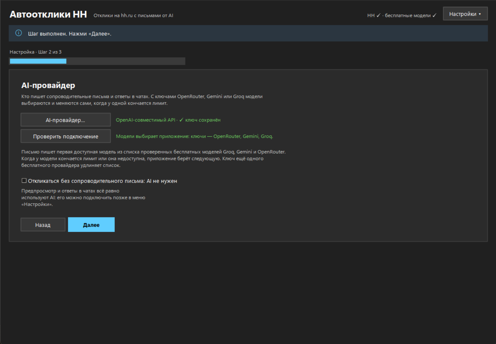
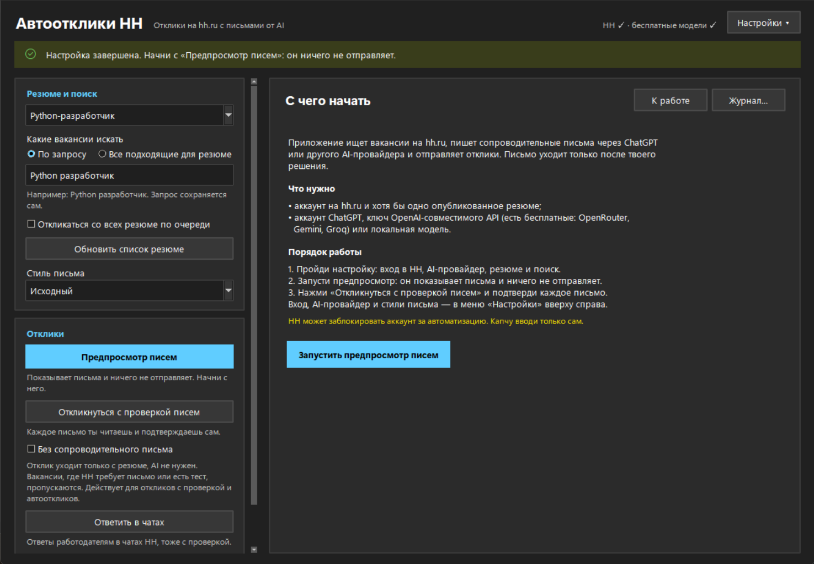
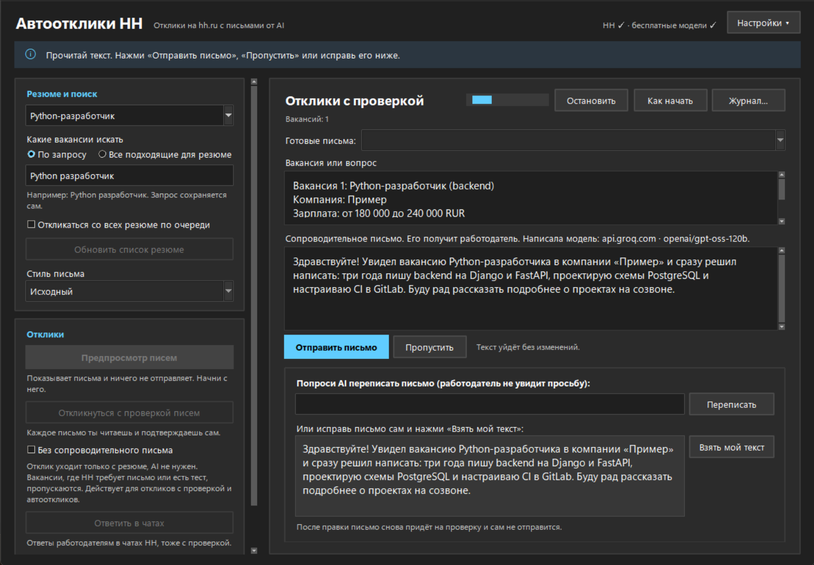

# Первые шаги с «Автоотклики HH»

Это руководство поможет скачать программу, установить её и сделать первый предпросмотр без отправки откликов.

## Что делает программа

Приложение ищет вакансии на hh.ru по выбранному резюме и запросу. Для каждого подходящего объявления оно может подготовить сопроводительное письмо с помощью выбранного AI-провайдера. В режиме проверки вы читаете каждое письмо и сами решаете, отправлять его или пропустить. Есть отдельный режим без сопроводительного письма.

Автоматизация может нарушать правила hh.ru и привести к блокировке аккаунта. Капчу всегда вводит человек. Не оставляйте приложение без присмотра и не включайте автоматические отклики, пока не освоили проверку писем.

## 1. Скачайте установщик

1. Откройте [страницу загрузки](index.html) и нажмите «Скачать для Windows».
2. Если открылся GitHub, выберите файл `hh-applicant-tool-gui-<версия>-windows-x64-setup.exe`. Не скачивайте `code.zip`, `update.json` или файл с подписью — это не установщик.
3. Сохраните файл и дождитесь окончания загрузки. Обычно браузер кладёт его в папку «Загрузки».

Нужны Windows 10 или 11, 64 бит, аккаунт hh.ru и опубликованное резюме. Python устанавливать не надо. Для писем можно подключить AI-провайдера или выбрать режим без сопроводительного письма. Бесплатные лимиты провайдеров меняются и не гарантируются.

## 2. Проверьте файл

Сборка не подписана сертификатом издателя. Поэтому Windows SmartScreen может сообщить, что издатель неизвестен или запуск приложения защищён. Это предупреждение не означает автоматически, что файл вредоносный, и проверка суммы не удостоверяет издателя.

Перед запуском откройте страницу того же релиза и скачайте `SHA256SUMS.txt`. В PowerShell перейдите в папку «Загрузки» и выполните команду, подставив имя своего файла:

```powershell
Get-FileHash .\hh-applicant-tool-gui-<версия>-windows-x64-setup.exe -Algorithm SHA256
```

Сравните значение `Hash` с записью для файла с точно таким же именем в `SHA256SUMS.txt`. Если имя или сумма отличаются, файл не запускайте. Если Windows продолжает предупреждать и вы не уверены, отмените запуск. Не отключайте SmartScreen или антивирус ради установки.

## 3. Установите программу

1. Найдите установщик в папке «Загрузки» и откройте его.
2. Если проверка Windows не вызывает сомнений, следуйте шагам установщика.
3. Программа устанавливается только для вашей учётной записи, обычно в `%LOCALAPPDATA%\Programs\Автоотклики HH`. Права администратора не нужны.
4. Установщик может предложить ярлык на рабочем столе. Это необязательно.
5. После установки запустите «Автоотклики HH» через меню «Пуск» или ярлык.

## 4. Настройте вход и поиск

Мастер открывается по порядку: «Вход в HH» → «AI-провайдер» → «Резюме и поиск» → «Всё готово».

1. **Войдите в hh.ru.** Нажмите «Войти в HH», укажите email или телефон, затем введите код из письма или SMS в приложении. Никому не пересылайте код и не публикуйте его.
2. **Настройте письма.** Выберите AI-провайдера и следуйте его окну входа или инструкции для ключа. Ключ вводите только в приложение и не помещайте в текст ошибки или снимок экрана. Условия, доступность и бесплатные лимиты задаёт провайдер. Если не хотите подключать AI, выберите «Без сопроводительного письма» на следующем шаге.
3. **Выберите резюме и запрос.** Используйте опубликованное резюме и короткие слова о подходящей работе. Проверьте, что резюме и поиск подходят друг другу.
4. На экране «Всё готово» нажмите переход к откликам.

Мастер на снимке использует вымышленные данные.



Если вы выбрали режим без письма, приложение отправляет только резюме. Некоторые вакансии требуют письмо или тест; приложение их пропустит.

## 5. Сделайте первый предпросмотр

1. На главном экране убедитесь, что выбрано нужное резюме и поисковый запрос.
2. Нажмите «Предпросмотр писем». Этот шаг показывает подготовленные письма и сам ничего не отправляет.
3. Откройте письмо, сравните его с вакансией и проверьте каждое утверждение. Не оставляйте в резюме или письме сведения, которые не хотите отправлять работодателю.
4. Для отправки используйте отдельную кнопку отправки с проверкой. Вы также можете пропустить письмо, попросить AI переписать его или исправить текст самостоятельно.





Для автооткликов есть отдельный раздел с лимитом. Он отправляет письма без проверки каждого, поэтому сначала пользуйтесь предпросмотром и ручной проверкой. Лимит не защищает от ограничений или блокировки со стороны hh.ru.

## Капча, обновление и удаление

- **Капча.** Когда hh.ru попросит подтвердить действие, остановитесь и сами введите показанный текст. Пока окно капчи открыто, запуск ждёт. Не используйте сервисы обхода капчи.
- **Обновление.** Если приложение показывает кнопку «Обновить до X», она скачает обновление. Закройте незавершённую работу и проверьте номер версии перед обновлением.
- **Удаление.** Найдите «Автоотклики HH» в «Установленных приложениях» Windows и выберите удаление. Деинсталлятор не удаляет данные профиля. Их папки находятся в `%USERPROFILE%\.config\hh-applicant-tool-gui` и `%USERPROFILE%\.local\state\hh-applicant-tool-gui`. Не удаляйте их, если хотите сохранить настройки, профиль и журнал.

## Частые проблемы

| Ситуация | Что сделать |
| --- | --- |
| Не удаётся скачать файл | Откройте страницу [последнего стабильного релиза](https://github.com/nikchester/hh-applicant-tool-gui/releases/latest), проверьте соединение и выберите установщик `*-windows-x64-setup.exe`. |
| SmartScreen предупреждает о неизвестном издателе | Проверьте имя и SHA-256 по `SHA256SUMS.txt`. Если сумма не совпала или сомневаетесь — отмените запуск. Не отключайте защиту Windows. |
| Антивирус удалил файл | Не выключайте антивирус. Сверьте источник и SHA-256; если файл удалён или не совпадает, не восстанавливайте его. |
| Не получается войти в hh.ru | Проверьте, что код введён в окне программы, и запросите новый код на hh.ru. Никому его не отправляйте. |
| AI не отвечает или закончился лимит | Проверьте подключение и лимиты провайдера, затем попробуйте позже или выберите режим без письма. Не вставляйте ключ в обращение о проблеме. |
| Не открывается капча | Переключитесь на окно «Капча» через панель задач. Не закрывайте его, если хотите продолжить текущий запуск. |
| Программа закрывается при запуске | Запишите версию, текст сообщения и шаг, на котором возникла проблема. Не публикуйте журналы и диагностические файлы без проверки на личные данные. |

## Как сообщить о проблеме

Откройте [создание сообщения об ошибке](https://github.com/nikchester/hh-applicant-tool-gui/issues/new). Укажите версию программы, версию Windows, что вы нажали и точный текст ошибки. Не прикладывайте пароли, коды входа, ключи AI, файлы профиля, cookies, токены, полное резюме или непроверенные диагностические файлы.

## Данные и безопасность

Не сообщайте никому пароль hh.ru, коды из писем и SMS или ключ AI. Не публикуйте журнал до проверки: в нём могут быть тексты писем. Не включайте реальные личные данные в снимки экрана. Приложение отправляет отклики от вашего имени; проверяйте текст и вакансию до отправки.
